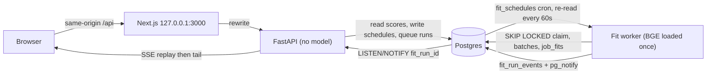
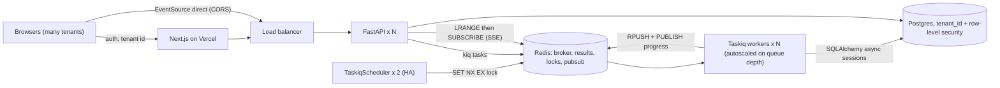

# ADR-0001: Single-tenant Postgres-backed task pipeline for job fit scoring

## Context

Job Hunt OS scores every collected job against San's brag bank and selected resume. A single fetch brings thousands of jobs, and the first full scoring pass covers roughly 6,000 jobs and takes minutes, so scores must be pre-computed and stored. The cron that triggers scoring must be editable from the UI and stored in the database. A scoring run must keep reporting progress even if the browser tab is closed and reopened.

The app has exactly one user, runs on one laptop inside Docker, and already has Postgres with a psycopg 3 connection pool. There is no login, no hosted deployment, and no second machine.

A generic async-task specification was considered. It targets a multi-tenant, horizontally scaled deployment: Taskiq workers over Redis, a high-availability scheduler with Redis locks, Server-Sent Events fed by Redis lists and pub/sub, SQLAlchemy 2.0 with async drivers, and workarounds for serverless request timeouts. That specification solves problems this deployment does not have, and it asks for a rewrite of the data layer.

Two options were weighed.

### Option A: single-tenant, Postgres as the whole pipeline

The queue is a table (`fit_runs`). The worker claims one row at a time with `FOR UPDATE SKIP LOCKED`, and a Postgres advisory lock keeps a single run active. Progress is an append-only table (`fit_run_events`) plus `LISTEN/NOTIFY`. The browser receives it as a Server-Sent Events stream through the same-origin Next.js rewrite. Schedules live in `fit_schedules` and the worker re-reads them every minute, so a cron edit applies without a restart.

### Option B: multi-tenant, broker-backed

Every request carries a tenant, every table carries `tenant_id` with row-level security, and Redis holds the queue, the results, the scheduler lock, and the progress history.

### Comparison

| | A: single-tenant | B: multi-tenant |
|---|---|---|
| Infrastructure | 4 services: postgres, api, ui, fit-worker | 7 or more: adds Redis, a scheduler pair, and worker autoscaling |
| Tenant isolation | None needed | `tenant_id` on every row, row-level security, authentication, per-tenant quotas |
| Run-once guarantee | Advisory lock, `SKIP LOCKED`, idempotency key | Redis `SET NX EX`, idempotency key |
| Progress durability | `fit_run_events` table plus `NOTIFY` | Redis list with a TTL plus pub/sub |
| Data layer | Unchanged (psycopg 3) | Rewritten to SQLAlchemy async |
| Privacy | Bank and resume text never leave the laptop | Personal data in the cloud: encryption, consent, deletion flows |
| Cost | Free, local | Hosted Redis, workers, and Postgres |

## Decision

We will run a single-tenant, local pipeline. Postgres is the queue, the lock, the schedule store, and the progress log. One fit worker process loads the scoring model once and polls every 60 seconds. The browser receives progress as Server-Sent Events through the same-origin Next.js rewrite.

We will not add Redis, Taskiq, SQLAlchemy async, authentication, or tenant columns.

The run-once and durability properties of option B are kept, implemented with Postgres:

- A run is claimed with `UPDATE … WHERE id = (SELECT id FROM fit_runs WHERE status = 'queued' ORDER BY queued_at FOR UPDATE SKIP LOCKED LIMIT 1)`.
- An idempotency key, the sha256 of the schedule, the mode, the source hash, and the time slot, stops a double-clicked Run now or a schedule firing twice from queueing a second run.
- Each batch of jobs commits its scores and a progress event in one transaction, then calls `pg_notify`. A crash keeps every finished batch, and the restarted run scores only the jobs still missing.
- The stream endpoint listens on the run's channel before replaying history, and the browser resumes from the `Last-Event-ID` header, so a reconnect neither skips nor repeats an event.

## Consequences

### Positive

- Four containers instead of seven or more, and one database to back up.
- The brag bank and resume text stay on the laptop.
- The data layer is not rewritten, so the change stays inside the fit feature.
- A run survives a worker crash and a closed browser tab, the same guarantees option B offers.

### Negative

- There is no horizontal scaling. One worker means one run at a time, so a long full rescore delays the next scheduled run.
- A `NOTIFY` payload is small, so the worker sends an event id and the stream reads the row. That is one extra query per progress event.
- Moving to multiple users later is a real migration: tenant columns, row-level security, authentication, and a broker.

### Neutral

- The boundaries match option B's concepts. `JobFitModel` is the task body, `fit_runs` is the queue, and the SSE route shape is the same. A later move replaces the transport, not the UI.

## Revisit when

Write a new ADR that supersedes this one, starting from option B, when any of these becomes true:

- A second user, or a hosted UI, is wanted.
- A full rescore regularly takes longer than the gap between scheduled runs.
- A scoring strategy needs a GPU or workers on another machine.
