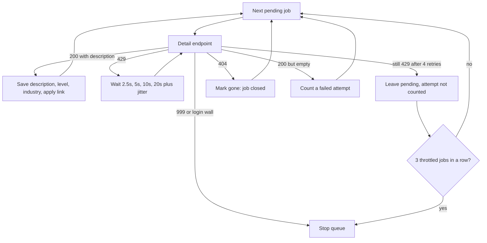

# ADR-0008: LinkedIn detail fetch retries a soft 429

## Context

Search cards from the LinkedIn guest endpoint have no description. `drain_details` fetches each one from `jobs-guest/jobs/api/jobPosting/{id}`. `HttpClient` raises `SourceBlocked` on the first HTTP 429, and the tick stopped the whole queue on that exception. From 12 October 2026 every LinkedIn run ended in a 429, and 186 postings sat at `pending` with no attempt recorded.

Live requests on 14 October showed the 429 is a short throttle, not an IP ban. The same URL returned 200 within a few seconds. A 999 is different: it is a block on the IP, and waiting does not clear it.

## Decision

Keep the guest detail endpoint and the existing 6 to 8 second gap between requests. On a 429, retry after 2.5s, 5s, 10s, and 20s, each plus up to 1 second of jitter. If it is still 429, leave the posting `pending` and do not count an attempt. Stop the queue after three throttled postings in a row.

Stop immediately on a 999 or a login wall, again without counting an attempt. A 404 sets `detail_status` to `gone`, so a backfill does not queue a removed job again. A 200 with no description counts as a failed attempt. One network error is retried once.

`jobhunt details backfill --source linkedin_guest` puts every open job with an empty description back on the queue, skipping `gone`, then drains until the queue is empty or a block stops it. It refuses to run on the corporate network and takes the same per-source lock as the tick.

## Evidence

Checked on 14 October 2026 from a home IP, one request at a time, read only:

- Detail endpoint at 6 to 8 seconds, after a search poll: 25 of 25 descriptions. 12% of first tries were 429, and each cleared in 2.4 to 2.5 seconds.
- Detail endpoint at 3 to 4 seconds: 24 of 25 (one network error). 32% of first tries were 429.
- Public job page fetched on each 429: 24 of 25, but 56% of first tries were 429. The larger page makes the detail endpoint worse.
- Public job page alone: 10 of 20, with a 50% 429 rate.

JobSpy retries LinkedIn 429s at 5s, 15s, and 35s. The jobseek crawler retries four times starting at 1.5s.

## Rejected

- The public `/jobs/view/{id}/` page as a fallback or as the main source. It raised the 429 rate.
- A 3 to 4 second gap. It is faster, and it triples the 429 rate. The current gap already clears a backlog of this size in about five ticks.
- `curl_cffi`, proxies, a logged-in cookie, and paid job APIs. The retries cleared every 429 in the test. A 999 still needs a different IP.

## Consequences

- A tick that drains 40 descriptions takes about 5 to 6 minutes.
- A 999 still stops the queue. Slowing down does not clear it.
- `postings.detail_status` may be `gone`. The check constraint allows it. Older app versions that write only `pending`, `done`, and `failed` keep working.
